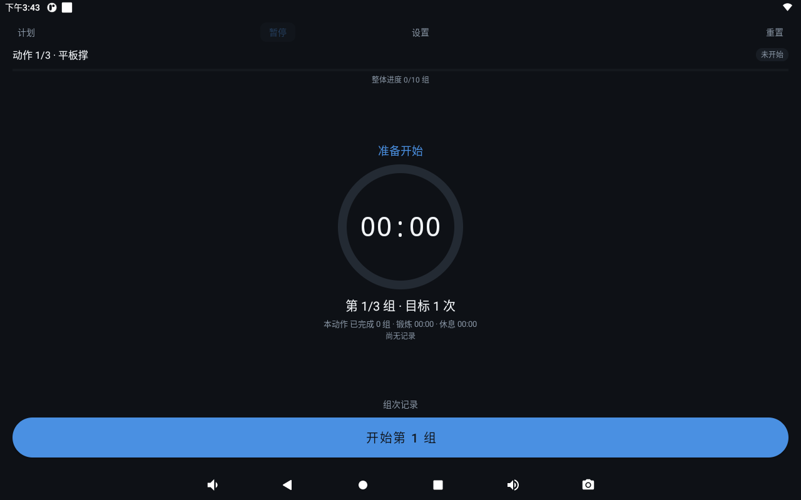
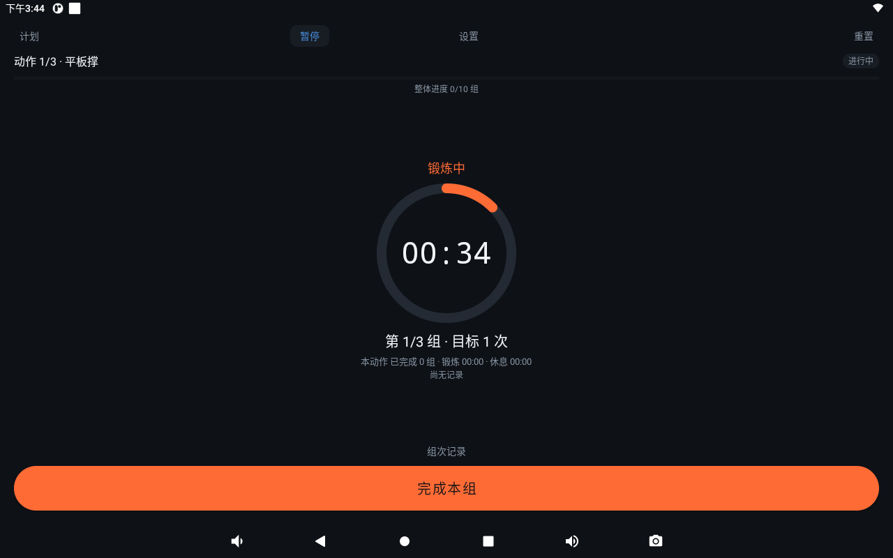
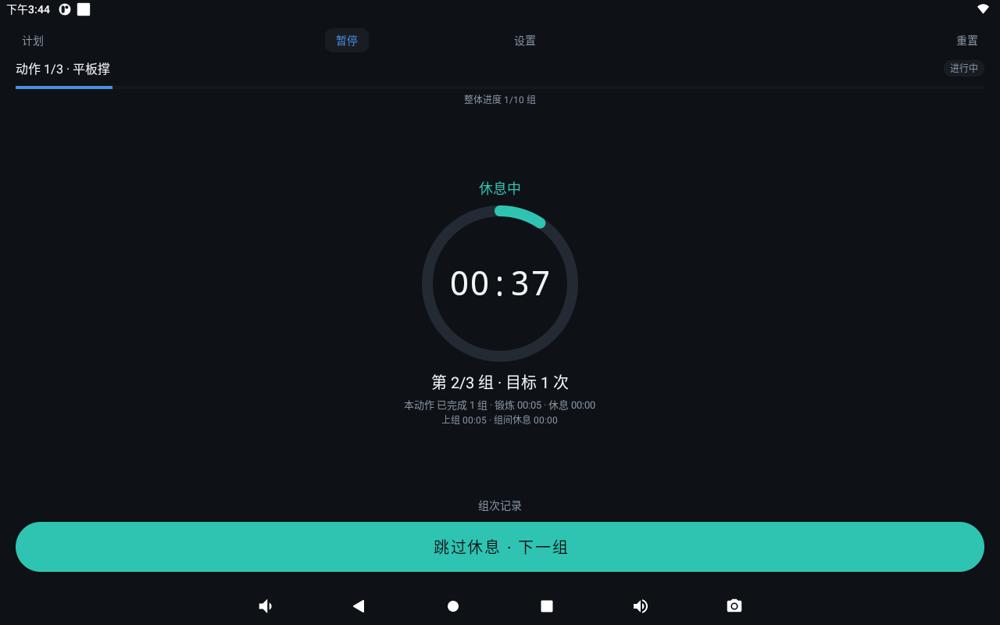
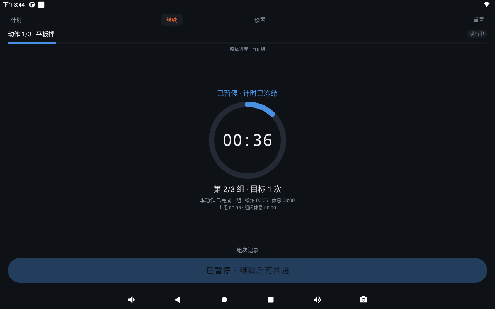
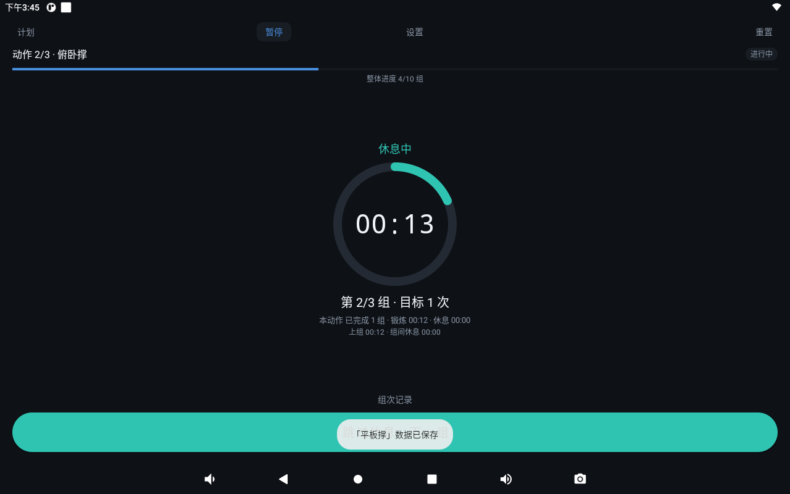
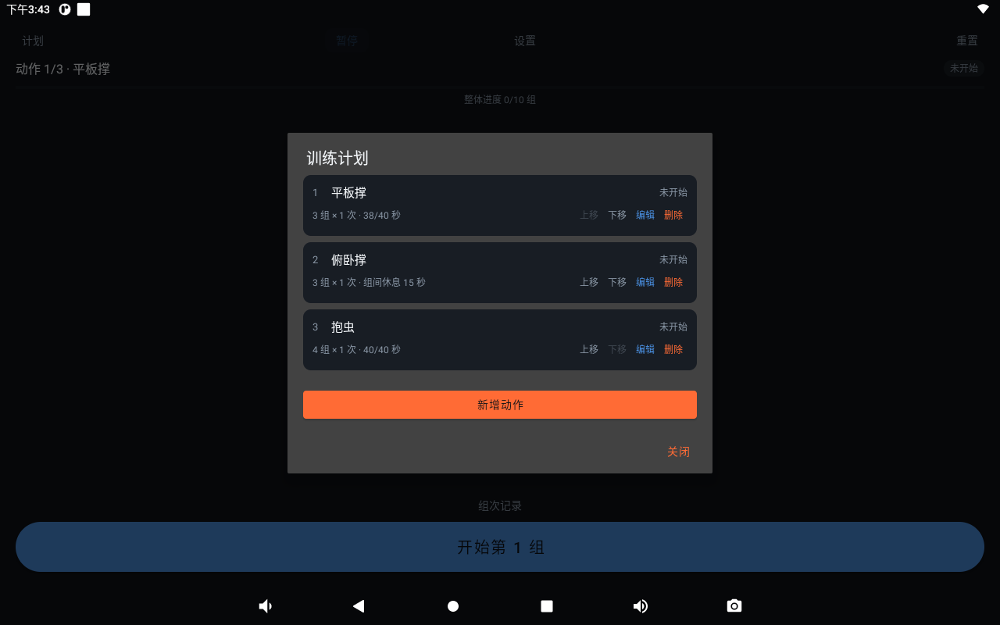
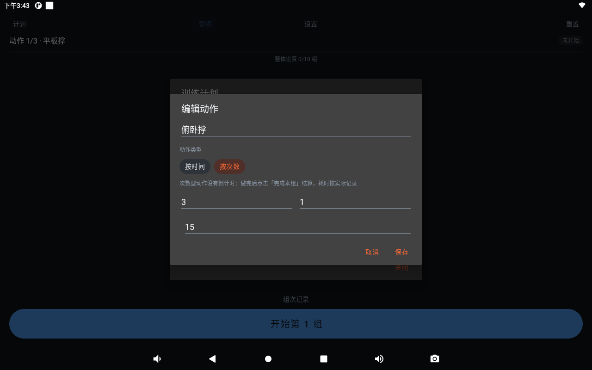
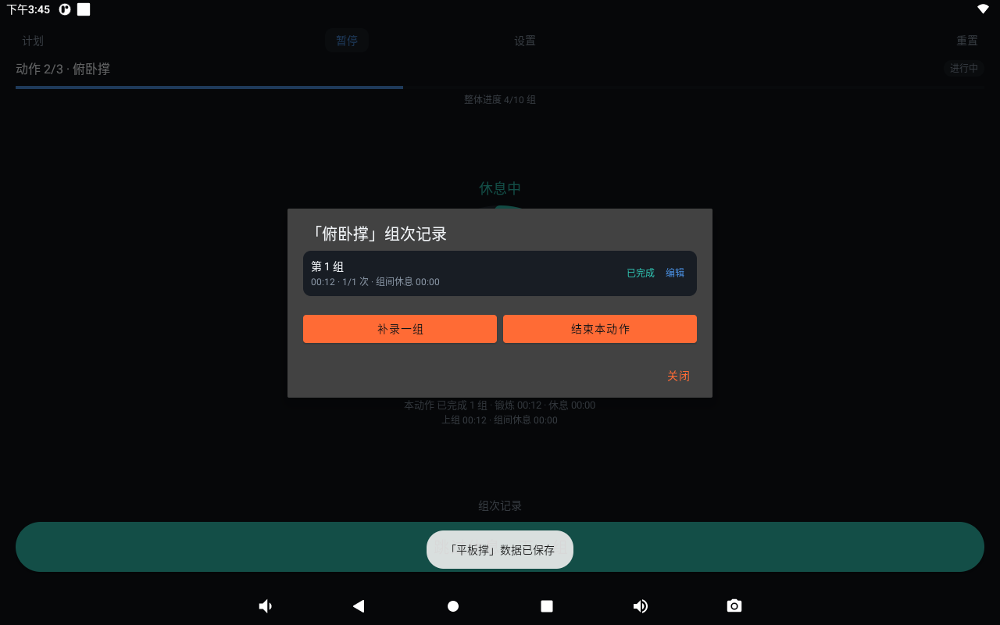
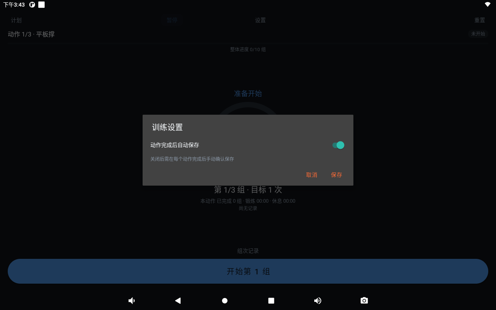

# TrainAlarm

**English** | [简体中文](README.zh-CN.md)

> A minimalist, single-screen interval timer for Android workouts.
> Precise countdowns, one-tap set counting, multi-exercise plans, pause/resume, and repetition-based
> exercises — with every state change persisted in real time, so nothing is lost when the app is
> backgrounded or the process is killed.


---

## Table of Contents

- [Features](#features)
- [Screenshots](#screenshots)
- [Requirements](#requirements)
- [Build & Install](#build--install)
- [Usage](#usage)
- [Project Structure](#project-structure)
- [Testing](#testing)
- [FAQ](#faq)
- [License](#license)

---

## Features

### Precise countdown that never drifts

The engine is timestamp-based instead of relying on a tick counter: the remaining time is always
derived from `phase start time + phase duration`. Backgrounding the app, locking the screen, or even
killing the process and reopening it does not shift the clock. When the app returns to the
foreground, the engine catches up by replaying the phases that elapsed in the meantime.

### Real-time persistence and crash recovery

Every state change (phase, set record, exercise status, pause state) is written to
`SharedPreferences` immediately. A custom line-based text format is used; a single corrupted record
is skipped, and a corrupted snapshot falls back to a safe initial state instead of crashing.
Legacy snapshots written by older versions are still parsed correctly (missing fields fall back to
their defaults).

### One-tap set counting

The main button is a single, large, always-visible action. Depending on the current phase it becomes
*Start set N*, *Finish set*, *Skip rest · next set*, *Save & next exercise*, or *Save & finish* —
so any step of the flow is one tap away.

### Automated flow

When the work countdown reaches zero the set is recorded automatically and the rest phase starts.
When the rest ends, the app clearly prompts the user to start the next set. No manual bookkeeping.

### Pause & resume

Pause freezes the work countdown, the rest countdown, and the stopwatch of repetition-based
exercises; the main button is locked with a *Paused · resume to continue* hint. The paused duration
is excluded from the recorded workout/rest time, and the pause state survives backgrounding and
process death.

### Time-based and repetition-based exercises

- **Time mode** — a countdown runs for the set; the set is settled automatically when it hits zero.
- **Rep mode** — for push-ups, squats, crunches and the like. There is no countdown; a forward
  stopwatch runs instead, and the user taps *Finish set* when done. The set is recorded with the
  target repetitions and the actual elapsed time (not limited by the configured duration).

### Multi-exercise plans and set management

Exercises can be added, edited, reordered, and deleted. Each exercise has its own set count,
target repetitions, work duration, and rest duration. Per-set records can be reviewed, back-filled,
and amended; saved exercises become read-only for traceability.

### Visual and audio feedback

A custom-drawn ring progress indicator surrounds the countdown; a `ToneGenerator` beep and a
vibration pattern announce phase switches, pause/resume, save success and warnings, plus a
countdown tick during the last three seconds.

### Data integrity validation

Before an exercise is saved, the record is validated: set indices must be continuous, durations and
repetition counts must be non-negative and within the configured bounds (rep mode is exempt from
the work-duration cap). If validation fails, the flow does not advance and the exact problem is
reported to the user.

---

## Screenshots

| Main screen · ready | Work countdown | Rest countdown |
| :---: | :---: | :---: |
|  |  |  |
| Single-screen layout, current exercise, overall progress | Ring progress + countdown in the work phase | Rest phase starts automatically after a set |

| Paused · timers frozen | Rep-mode stopwatch | Training plan |
| :---: | :---: | :---: |
|  |  |  |
| Countdown frozen, main action locked | Rep-based exercise counting up instead of down | Add / edit / reorder / delete exercises |

| Exercise editor | Set records | Settings |
| :---: | :---: | :---: |
|  |  |  |
| Choose *By time* or *By reps* per exercise | Review, back-fill and amend each set | Auto-save toggle |

---

## Requirements

| Item | Version |
| --- | --- |
| Android Studio | 4.1 or later |
| JDK | 8 or 11 |
| Gradle | 6.8.3 (via the wrapper) |
| Android Gradle Plugin | 4.1.0 |
| Kotlin | 1.5.31 |
| Android SDK Platform | API 29 (Android 10) |
| Android Build Tools | 29.0.3 |
| minSdk / targetSdk | 21 (Android 5.0) / 29 |
| Device | Any Android 5.0+ device with a vibrator (optional) |

Runtime dependencies: AndroidX Core-KTX, AppCompat, Material Components, ConstraintLayout.
No third-party networking, analytics, or ad libraries are used — the app works fully offline.

---

## Build & Install

1. Clone the repository

   ```bash
   git clone https://github.com/xxss0903/trainalarm.git
   cd trainalarm
   ```

2. Point Gradle at your Android SDK — create `local.properties` in the project root
   (this file is git-ignored):

   ```properties
   sdk.dir=/path/to/Android/Sdk
   ```

   On Windows use a forward-slash or escaped path, e.g. `sdk.dir=C:/Users/you/AppData/Local/Android/Sdk`.

3. Build the debug APK

   ```bash
   # macOS / Linux
   ./gradlew assembleDebug

   # Windows
   gradlew.bat assembleDebug
   ```

   The APK is written to `app/build/outputs/apk/debug/app-debug.apk`.

4. Install it on a connected device or emulator

   ```bash
   adb install -r app/build/outputs/apk/debug/app-debug.apk
   ```

Alternatively, open the project in Android Studio and press **Run ▶**.

> If `JAVA_HOME` is not set, point it at a JDK 8/11 installation before running Gradle,
> e.g. `export JAVA_HOME=/path/to/jdk-11` (macOS/Linux) or
> `$env:JAVA_HOME="C:\path\to\jdk-11"` (PowerShell).

---

## Usage

1. **Build a plan** — tap **Plan** in the top bar, then **Add exercise**. For each exercise set the
   name, the exercise type (*By time* / *By reps*), the number of sets, the target repetitions, the
   rest between sets and, for time-based exercises, the work duration. Common duration presets
   (`30/15`, `40/20`, `40/40`, `45/15`) fill the work/rest fields in one tap.
2. **Start training** — the main button starts set 1 of the first exercise. During the work phase
   the ring fills up while the countdown runs down.
3. **Finish a set** — wait for the countdown (time mode) or tap **Finish set** when done (rep mode).
   The set is recorded and the rest countdown starts automatically.
4. **Move on** — tap **Skip rest · next set** to start the next set early, or let the rest finish.
   After the last set, tap **Save & next exercise** to store the exercise and switch to the next one.
5. **Pause whenever needed** — tap **Pause** in the top bar; all timers freeze and the main button is
   locked. Tap **Continue** to resume exactly where you left off, with the paused time excluded from
   the records.
6. **Review the data** — tap **Set records** to inspect, back-fill or amend the sets of the current
   exercise. Saved exercises are read-only.
7. **Reset** — **Reset** clears all set records and flow state while keeping the plan itself.

Default parameters for a new exercise: **3 sets × 1 rep, 30 s work / 15 s rest**.

---

## Project Structure

```
TrainAlarm/
├── app/
│   ├── build.gradle
│   └── src/
│       ├── main/
│       │   ├── AndroidManifest.xml
│       │   ├── java/com/xxss0903/trainalaram/
│       │   │   ├── MainActivity.kt              # single-screen UI + dialogs
│       │   │   ├── TimeFormat.kt                # duration / countdown formatting
│       │   │   ├── data/WorkoutRepository.kt    # session persistence (SharedPreferences)
│       │   │   ├── feedback/FeedbackPlayer.kt   # ToneGenerator beeps + vibration
│       │   │   ├── timer/WorkoutModels.kt       # domain models + serialization
│       │   │   ├── timer/WorkoutSessionEngine.kt# pure-Kotlin training state machine
│       │   │   └── widget/ProgressRingView.kt   # custom ring progress view
│       │   └── res/                             # layouts, strings, colors, themes
│       ├── test/                                # JVM unit tests for the engine
│       └── androidTest/                         # instrumented smoke test
├── docs/screenshots/                            # screenshots used by this README
├── build.gradle
├── settings.gradle
└── gradle/wrapper/
```

`WorkoutSessionEngine` has no Android dependency at all — the clock is injected, which makes the
whole flow (including pause, catch-up and rep mode) unit-testable on the JVM.

---

## Testing

Run the unit tests with:

```bash
# macOS / Linux
./gradlew testDebugUnitTest

# Windows
gradlew.bat testDebugUnitTest
```

The suite contains **36 engine test cases** plus the sample test, covering:

- precise countdown and progress calculation;
- automatic work → rest → next-set transitions;
- set counting accuracy and overall progress;
- pause freezing, main-flow locking, and pause surviving a snapshot round trip;
- rep-mode stopwatch behaviour and manual settlement;
- multi-exercise sequential switching and per-exercise saving;
- save-time data validation, set back-filling and amendment;
- snapshot round trip, corrupted-data tolerance and legacy-format compatibility.

---

## FAQ

**Does the countdown drift when the app is in the background?**
No. The remaining time is always recomputed from the phase start timestamp, and on resume the
engine fast-forwards through the phases that elapsed while the app was away.

**Will I lose data if the app is killed?**
No. State is written on every change, and a snapshot restore mechanism brings back the current
exercise, phase, set records and pause state.

**How is the duration of a rep-based set recorded?**
Rep-based sets have no countdown. The elapsed time is measured by a stopwatch and recorded as the
actual duration when you tap *Finish set*; it is intentionally not capped by the configured work
duration.

**Does pausing affect the recorded workout time?**
No. Paused time is tracked separately and subtracted, so the pause never inflates the workout or
rest duration of a set.

**Why does the app request the `VIBRATE` permission?**
Only to give haptic feedback on phase switches and pause/resume. There is no audio recording,
storage, or network permission in the app.

**Can I change the default duration or the presets?**
The defaults live in `WorkoutLimits` (`WorkoutModels.kt`), and the preset chips are defined in
`res/layout/dialog_exercise_edit.xml`. Both are plain, easily editable sources.

**Where are my training records stored?**
In the app's private `SharedPreferences`. Uninstalling the app or clearing its data removes them.

**The build fails with an Android SDK error — what should I check?**
Make sure `local.properties` points to a valid SDK, that SDK Platform 29 and Build Tools 29.0.3 are
installed, and that Gradle is running on JDK 8 or 11.

---

## License

This project is released under the [MIT License](LICENSE).

```
Copyright (c) 2026 xxss0903
```
