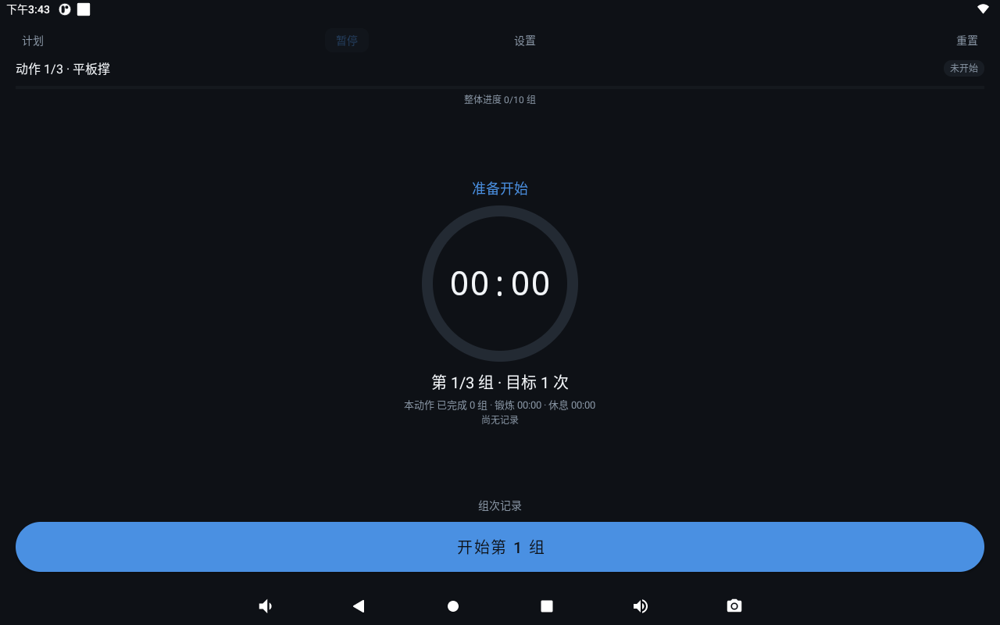
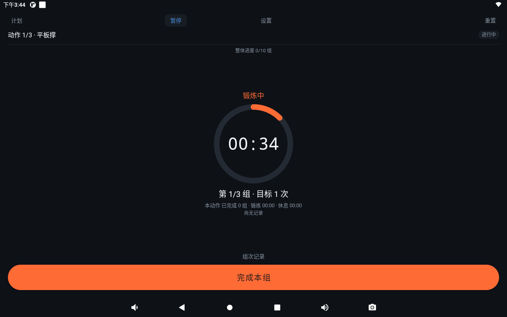
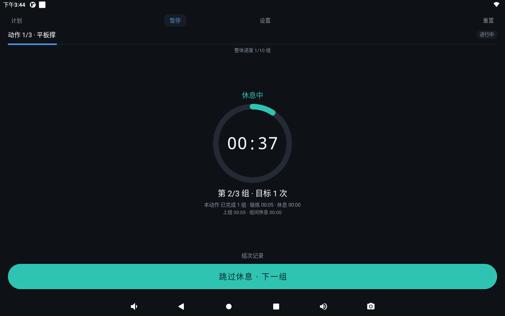
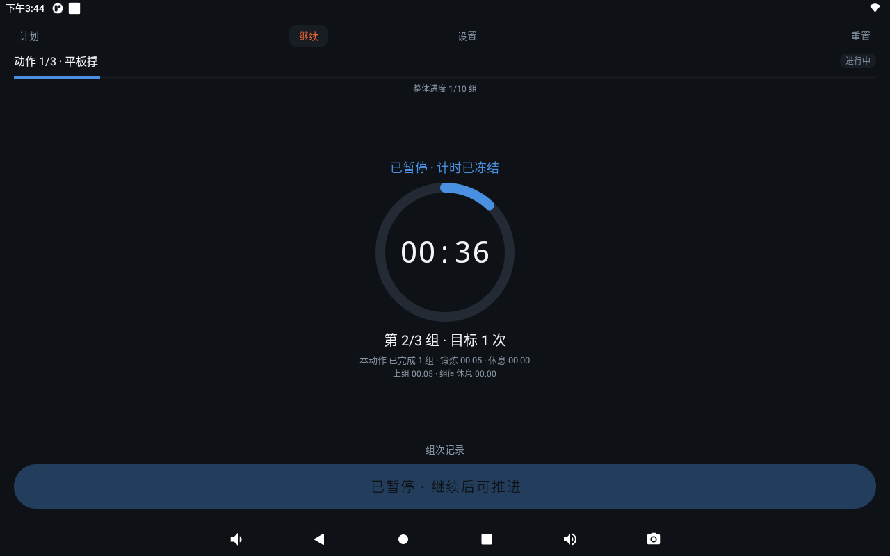
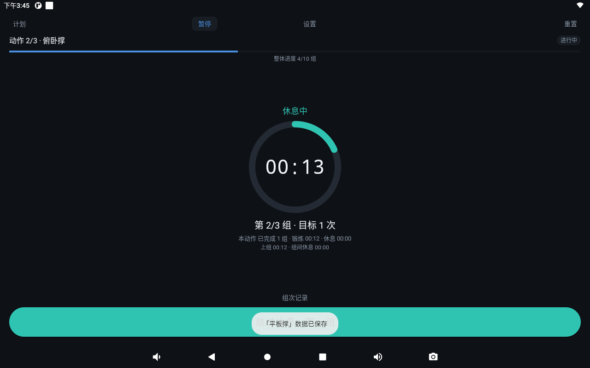
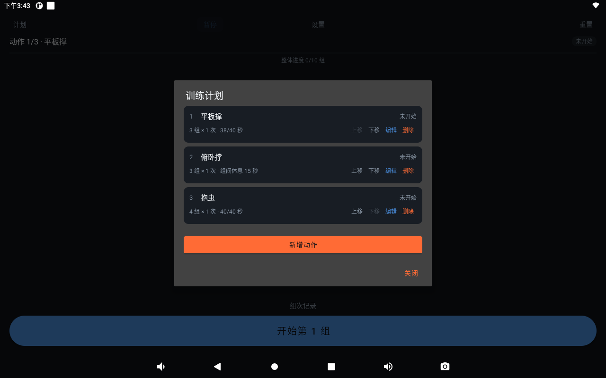
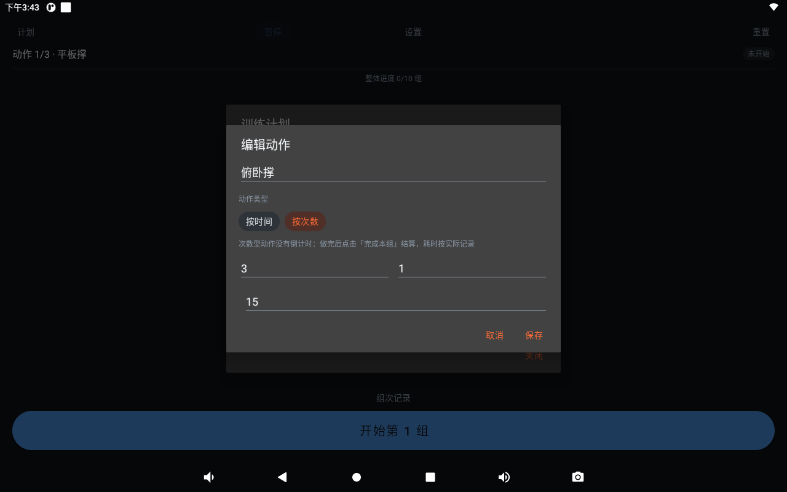
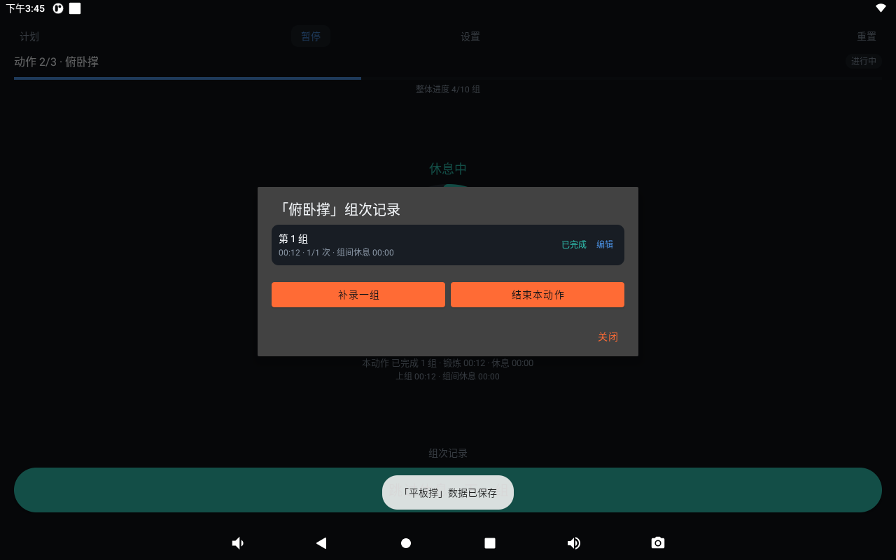
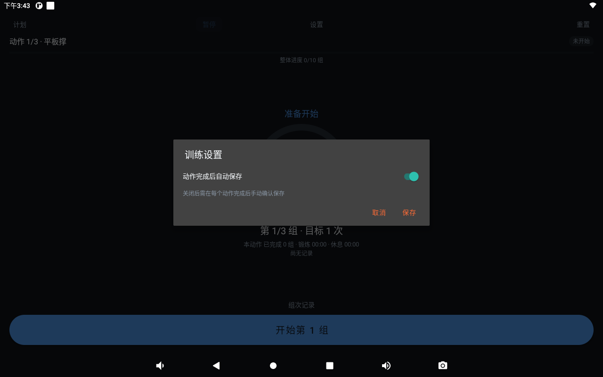

# TrainAlarm

[English](README.md) | **简体中文**

> 一款极简单屏的 Android 锻炼计时器。
> 精准倒计时、一键组次计数、多动作训练计划、暂停/继续、按次数动作——
> 所有状态实时持久化，切后台或进程被杀都不会丢数据。


---

## 目录

- [功能特性](#功能特性)
- [界面截图](#界面截图)
- [环境要求](#环境要求)
- [编译与安装](#编译与安装)
- [使用说明](#使用说明)
- [项目结构](#项目结构)
- [测试](#测试)
- [常见问题](#常见问题)
- [开源协议](#开源协议)

---

## 功能特性

### 精准倒计时，后台不漂移

引擎基于时间戳而非累加式的 tick 计数：剩余时间始终由「阶段起始时刻 + 阶段时长」计算得出。
切后台、锁屏、甚至杀掉进程后重新打开，计时都不会偏移；回到前台时引擎会自动补算期间流逝的阶段。

### 实时持久化与中断恢复

每一次状态变更（阶段、组次记录、动作状态、暂停状态）都会立刻写入 `SharedPreferences`。
采用逐行文本序列化格式：单条记录损坏会被跳过，快照顶层损坏会回退到安全的初始状态而不会崩溃。
旧版本写入的快照依然可以正确解析（缺失字段按默认值处理）。

### 一键组次计数

主按钮始终只有一个、大号、位于视觉核心位置。它会随阶段自动切换文案：
*开始第 N 组* / *完成本组* / *跳过休息 · 下一组* / *保存并进入下一动作* / *保存并完成训练*，
任何一步操作都只需 1 次点击。

### 流程自动化

锻炼倒计时归零后，本组自动结算并进入休息阶段；休息结束后明确提示可开始下一组，无需手工记账。

### 暂停与继续

暂停会同时冻结锻炼倒计时、休息倒计时以及次数型动作的秒表，并锁定主按钮（提示「已暂停 · 继续后可推进」）。
暂停时长不计入该组的锻炼/休息记录；暂停状态随快照持久化，切后台、进程被杀后恢复仍保持暂停。

### 按时间 / 按次数两种动作类型

- **按时间**：本组有倒计时，时间到自动结算。
- **按次数**：适用于俯卧撑、深蹲、卷腹等动作。本组没有倒计时，改为正向秒表计时，
  练完点击「完成本组」即按目标次数结算，耗时按实际用时记录，且不受配置的锻炼时长上限约束。

### 多动作计划与组次管理

支持动作的新增、编辑、排序、删除；每个动作可单独配置组数、目标次数、每组时长与组间休息。
组次记录可查看、补录与修改；已保存的动作转为只读，便于回溯。

### 视听双重反馈

自绘环形进度条环绕倒计时；阶段切换、暂停/继续、保存成功、校验失败均有 `ToneGenerator` 提示音与振动反馈，
倒计时最后 3 秒还有逐秒提示音。

### 数据完整性校验

动作保存前会校验：组号必须连续、时长与次数不得为负且不超过配置上限（次数型动作豁免时长上限）。
校验不通过则不推进流程，并明确告知具体问题。

---

## 界面截图

| 主界面 · 准备开始 | 锻炼倒计时 | 组间休息 |
| :---: | :---: | :---: |
|  |  |  |
| 极简单屏布局，显示当前动作与整体进度 | 环形进度 + 倒计时（锻炼阶段） | 本组结束后自动进入休息阶段 |

| 已暂停 · 计时冻结 | 按次数动作秒表 | 训练计划管理 |
| :---: | :---: | :---: |
|  |  |  |
| 倒计时冻结，主流程被锁定 | 次数型动作改为正向计时 | 动作的新增 / 编辑 / 排序 / 删除 |

| 动作编辑 | 组次记录 | 训练设置 |
| :---: | :---: | :---: |
|  |  |  |
| 每个动作可选择「按时间 / 按次数」 | 查看、补录与修改每一组 | 自动保存开关 |

---

## 环境要求

| 项目 | 版本 |
| --- | --- |
| Android Studio | 4.1 及以上 |
| JDK | 8 或 11 |
| Gradle | 6.8.3（随 wrapper 提供） |
| Android Gradle Plugin | 4.1.0 |
| Kotlin | 1.5.31 |
| Android SDK Platform | API 29（Android 10） |
| Android Build Tools | 29.0.3 |
| minSdk / targetSdk | 21（Android 5.0） / 29 |
| 运行设备 | Android 5.0 及以上，带振动马达（可选） |

运行时依赖：AndroidX Core-KTX、AppCompat、Material Components、ConstraintLayout。
不包含任何第三方网络、统计或广告库，完全离线可用。

---

## 编译与安装

1. 克隆仓库

   ```bash
   git clone https://github.com/xxss0903/trainalarm.git
   cd trainalarm
   ```

2. 配置 Android SDK 路径 —— 在项目根目录创建 `local.properties`（该文件已被 git 忽略）：

   ```properties
   sdk.dir=/path/to/Android/Sdk
   ```

   Windows 下请使用正斜杠或转义路径，例如 `sdk.dir=C:/Users/you/AppData/Local/Android/Sdk`。

3. 编译 Debug 包

   ```bash
   # macOS / Linux
   ./gradlew assembleDebug

   # Windows
   gradlew.bat assembleDebug
   ```

   产物位于 `app/build/outputs/apk/debug/app-debug.apk`。

4. 安装到已连接的设备或模拟器

   ```bash
   adb install -r app/build/outputs/apk/debug/app-debug.apk
   ```

也可以直接用 Android Studio 打开工程，点击 **Run ▶** 运行。

> 若未配置 `JAVA_HOME`，请先指向 JDK 8/11，例如
> `export JAVA_HOME=/path/to/jdk-11`（macOS/Linux）或
> `$env:JAVA_HOME="C:\path\to\jdk-11"`（PowerShell）。

---

## 使用说明

1. **编排计划** —— 点击顶栏「计划」，再点「新增动作」。为每个动作设置名称、动作类型（按时间/按次数）、
   组数、目标次数、组间休息，按时间动作还需设置每组时长。常用时长预设（`30/15`、`40/20`、`40/40`、`45/15`）
   可一键填入时长与休息。
2. **开始训练** —— 主按钮启动第一个动作的第 1 组。锻炼阶段环形进度随倒计时填充。
3. **完成本组** —— 按时间动作等待倒计时归零自动结算；按次数动作练完后点击「完成本组」结算。
   本组记录写入后自动进入休息倒计时。
4. **继续推进** —— 点击「跳过休息 · 下一组」可提前开始下一组，也可等休息自然结束。
   当前动作最后一组完成后，点击「保存并进入下一动作」保存数据并切换到下一个动作。
5. **随时暂停** —— 点击顶栏「暂停」，所有计时冻结、主按钮锁定；点击「继续」从原处恢复，
   暂停时长不会计入记录。
6. **查看数据** —— 点击「组次记录」可查看、补录或修改当前动作的每一组；已保存的动作只可查看。
7. **重置** —— 「重置」会清空所有组次记录与流程状态，但保留训练计划本身。

新建动作的默认参数为：**3 组 × 1 次，每组 30 秒，组间休息 15 秒**。

---

## 项目结构

```
TrainAlarm/
├── app/
│   ├── build.gradle
│   └── src/
│       ├── main/
│       │   ├── AndroidManifest.xml
│       │   ├── java/com/xxss0903/trainalaram/
│       │   │   ├── MainActivity.kt              # 单屏主界面与各弹窗
│       │   │   ├── TimeFormat.kt                # 时长 / 倒计时格式化
│       │   │   ├── data/WorkoutRepository.kt    # 训练会话持久化（SharedPreferences）
│       │   │   ├── feedback/FeedbackPlayer.kt   # ToneGenerator 提示音 + 振动
│       │   │   ├── timer/WorkoutModels.kt       # 领域模型与序列化
│       │   │   ├── timer/WorkoutSessionEngine.kt# 纯 Kotlin 训练流程状态机
│       │   │   └── widget/ProgressRingView.kt   # 自绘环形进度条
│       │   └── res/                             # 布局、文案、颜色、主题
│       ├── test/                                # 引擎的 JVM 单元测试
│       └── androidTest/                         # 仪器化冒烟测试
├── docs/screenshots/                            # 本 README 使用的截图
├── build.gradle
├── settings.gradle
└── gradle/wrapper/
```

`WorkoutSessionEngine` 完全不依赖 Android：时钟由外部注入，因此整条流程（含暂停、跨阶段追赶、
次数型动作）都可以在 JVM 上做单元测试。

---

## 测试

运行单元测试：

```bash
# macOS / Linux
./gradlew testDebugUnitTest

# Windows
gradlew.bat testDebugUnitTest
```

测试套件包含 **36 个引擎用例** 以及示例用例，覆盖：

- 倒计时精度与进度计算；
- 锻炼 → 休息 → 下一组的自动流转；
- 组次计数准确性与整体进度；
- 暂停冻结、主流程锁定，以及暂停状态快照往返；
- 次数型动作正向秒表与手动结算；
- 多动作顺序切换与逐动作保存；
- 保存前数据校验、组次补录与修改；
- 快照往返、脏数据容错与旧格式兼容。

---

## 常见问题

**切到后台后倒计时会漂移吗？**
不会。剩余时间始终由阶段起始时间戳重新计算；回到前台时引擎会补算离开期间已经流逝的阶段。

**进程被杀会丢数据吗？**
不会。每次变更都会写入，恢复时会还原当前动作、阶段、组次记录与暂停状态。

**按次数动作的时长是怎么记录的？**
次数型动作没有倒计时，采用正向秒表计时，点击「完成本组」时把实际用时记为本次锻炼时长，
并且故意不受配置的每组时长上限约束。

**暂停会影响记录的锻炼时长吗？**
不会。暂停时长单独累计并在计算时扣除，因此不会虚增该组的锻炼或休息时长。

**为什么需要 `VIBRATE` 权限？**
仅用于阶段切换与暂停/继续时的振动反馈。应用没有录音、存储或网络权限。

**想改默认时长或预设选项怎么办？**
默认值在 `WorkoutModels.kt` 的 `WorkoutLimits` 中，预设选项在
`res/layout/dialog_exercise_edit.xml` 中，都是可直接编辑的源码。

**训练记录存在哪里？**
保存在应用私有的 `SharedPreferences` 中。卸载应用或清除应用数据会一并删除。

**编译时报 Android SDK 相关错误怎么办？**
确认 `local.properties` 指向有效的 SDK、已安装 SDK Platform 29 与 Build Tools 29.0.3，
并且 Gradle 运行在 JDK 8 或 11 上。

---

## 开源协议

本项目基于 [MIT License](LICENSE) 开源。

```
Copyright (c) 2026 xxss0903
```
